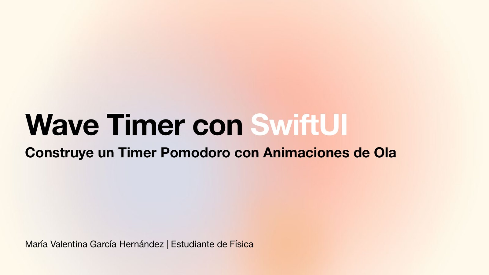
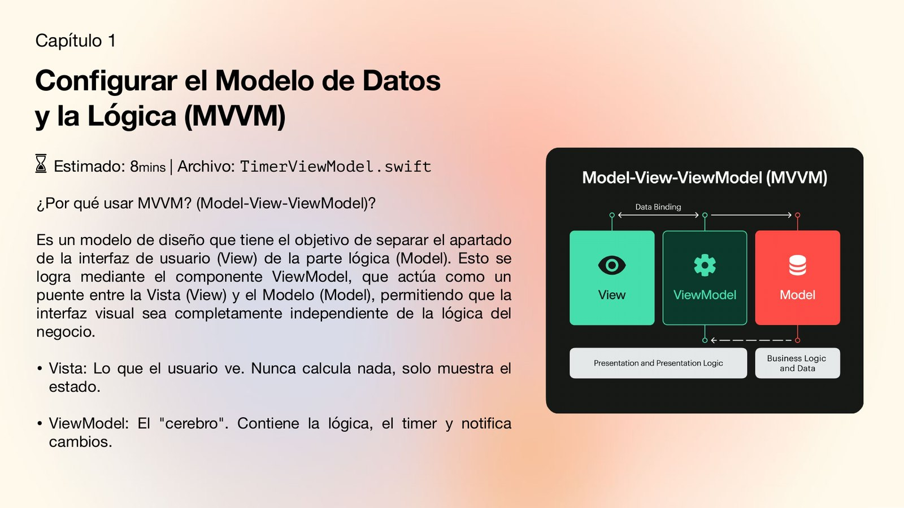
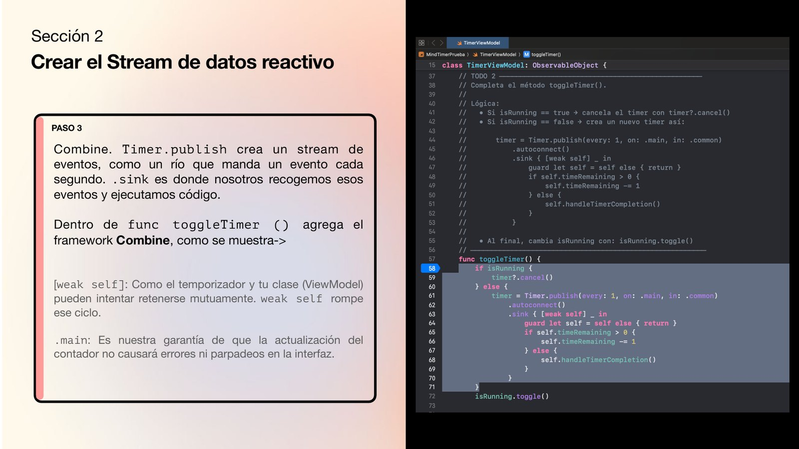
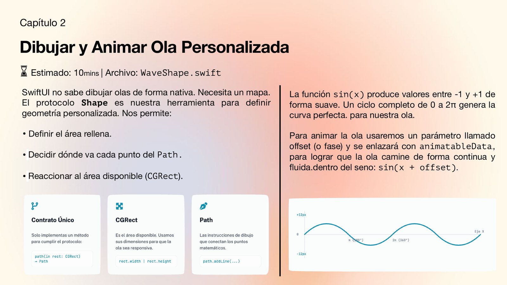
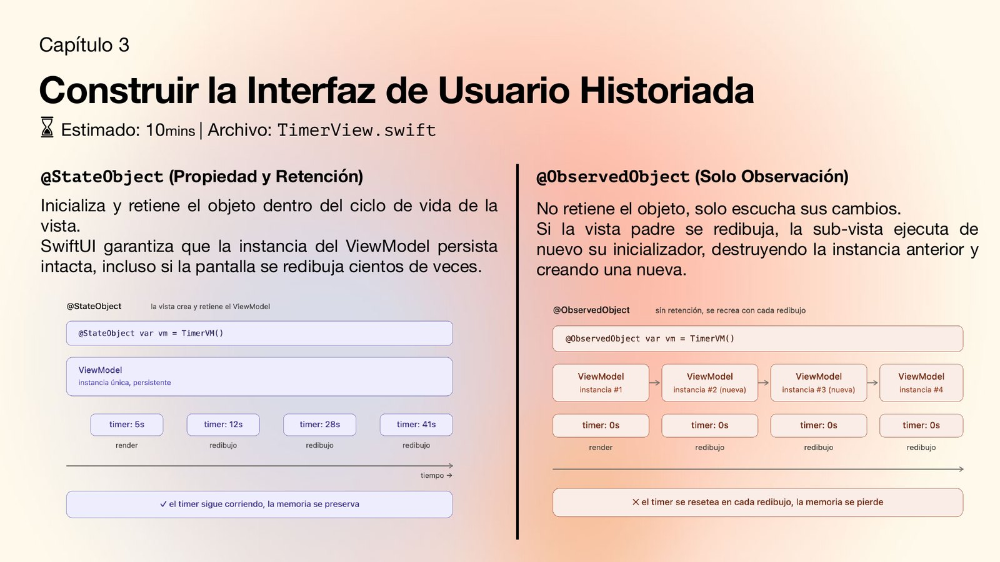
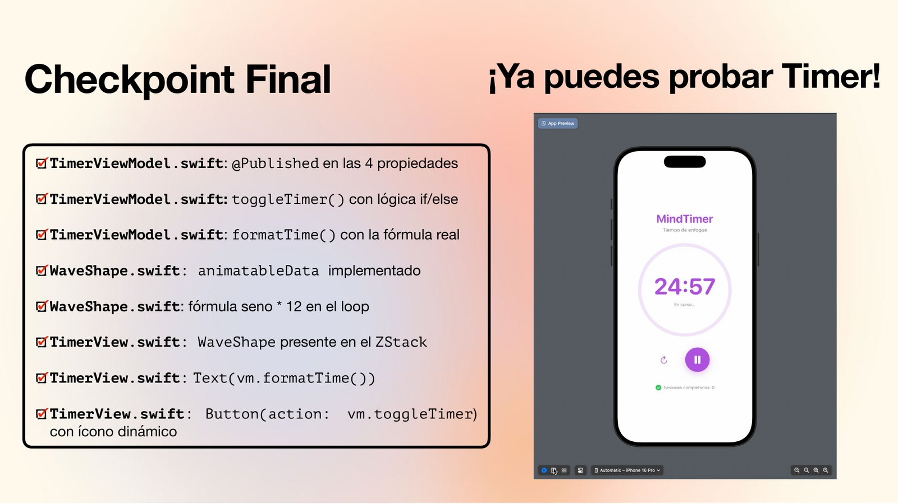

<div align="center">

[Español](README.md) | **English**

# Wave Timer with SwiftUI

**Hands-on workshop: build a Pomodoro timer with a wave animation**


</div>

<p align="center">
  
</p>

> The workshop materials (slides, presenter guide, cheat sheet and code comments) are in Spanish.

## Overview

This repository contains the materials for a hands-on SwiftUI workshop in which participants build **MindTimer** from scratch: an iOS Pomodoro timer with a wave animation that rises as time passes.

The workshop is based on the architecture of [MindTides](https://github.com/Valoo-1201/MindTides), a productivity app for college students developed for the Apple Swift Student Challenge. During the session, participants separate logic from the interface using the MVVM pattern, implement a reactive time stream with Combine, and design a custom animated shape with the `Shape` protocol.

**Audience:** students with basic Swift knowledge who have not yet completed a full app.

## Learning objectives

By the end of the workshop, each participant will have:

- Built a working Pomodoro timer app.
- Understood the MVVM architecture pattern and its purpose.
- Implemented a custom animated shape with the `Shape` protocol.
- Connected a `ViewModel` to a view using `@StateObject` and `@Published`.
- Used a reactive Combine timer with `Timer.publish`.

| Concept | Tool |
|---|---|
| Separate logic from the interface | MVVM and `ObservableObject` |
| Notify the view of changes | `@Published` |
| Draw custom shapes | `Shape` protocol and `Path` |
| Animate custom shapes | `animatableData` |
| Manage view state | `@StateObject` and `@ObservedObject` |
| Reactive timer | `Timer.publish` and Combine |

## Repository contents

```
.
├── starter/
│   └── MindTimer.swiftpm           Starter project with 8 exercises (TODO) to complete
├── completed/
│   └── MindTimerCompleto.swiftpm   Complete workshop solution
├── materiales/
│   ├── Presentacion.pdf            Workshop slides
│   ├── GuionTaller.md              Presenter guide: timing, explanations and questions
│   └── CheatSheet.md               Quick reference for participants
└── docs/images/                    Images used in this README
```

## Workshop outline

| Section | Time | File | Exercises |
|---|---|---|---|
| 1. Introduction and demo | 5 min | — | — |
| 2. MVVM architecture and the ViewModel | 8 min | `TimerViewModel.swift` | TODO 1 to 3 |
| 3. The wave shape with `Shape` | 10 min | `WaveShape.swift` | TODO 4 and 5 |
| 4. The main view | 10 min | `TimerView.swift` | TODO 6 to 8 |
| 5. Final demo and wrap-up | 5 min | — | — |

### Exercises

| TODO | File | Task |
|---|---|---|
| 1 | `TimerViewModel.swift` | Add `@Published` to the four state properties |
| 2 | `TimerViewModel.swift` | Implement `toggleTimer()` with `Timer.publish` and `sink` |
| 3 | `TimerViewModel.swift` | Implement `formatTime()` with the `MM:SS` format |
| 4 | `WaveShape.swift` | Implement `animatableData` |
| 5 | `WaveShape.swift` | Compute the wave height with the sine function |
| 6 | `TimerView.swift` | Add `WaveShape` to the `ZStack` |
| 7 | `TimerView.swift` | Display the time with `vm.formatTime()` |
| 8 | `TimerView.swift` | Connect the play/pause button to `vm.toggleTimer` |

## Slide preview

<table>
  <tr>
    <td width="50%"><br /><sub>Chapter 1: data model and logic (MVVM)</sub></td>
    <td width="50%"><br /><sub>Guided step: reactive data stream with Combine</sub></td>
  </tr>
  <tr>
    <td width="50%"><br /><sub>Chapter 2: drawing and animating the wave</sub></td>
    <td width="50%"><br /><sub>Chapter 3: <code>@StateObject</code> versus <code>@ObservedObject</code></sub></td>
  </tr>
</table>

<p align="center">
  
</p>

## Requirements

- iPad or Mac with Swift Playgrounds 4.4 or later, or a Mac with Xcode 15 or later.
- iOS or iPadOS 16 or later to run the app.

## How to use this repository

### Participants

1. Download the repository with **Code → Download ZIP** or clone it:
   ```bash
   git clone https://github.com/Valoo-1201/WaveTimer-SwiftUI-Workshop.git
   ```
2. Open `starter/MindTimer.swiftpm` in Swift Playgrounds or Xcode.
3. Follow the slides and complete exercises TODO 1 through TODO 8, in order.
4. Keep `materiales/CheatSheet.md` open as a reference during the workshop.
5. If needed, compare your work with the solution in `completed/MindTimerCompleto.swiftpm`.

### Presenters

1. Review `materiales/GuionTaller.md`, which includes timing, explanations, group questions and answers to common questions.
2. Have `completed/MindTimerCompleto.swiftpm` open and running for the opening demo.
3. Present `materiales/Presentacion.pdf` during the session.

## Expected result

When the finished app runs:

- The wave moves horizontally without stopping.
- Pressing play counts down the timer and raises the wave.
- Pressing pause freezes both the countdown and the fill.
- At `00:00`, the app switches to break mode (shown in green).
- The completed-sessions counter increases.

## Extension exercises

1. Add a second wave layer with an offset to create depth.
2. Play a sound when a session ends using `AVFoundation`.
3. Add haptic feedback with `UIImpactFeedbackGenerator`.
4. Persist completed sessions with `@AppStorage`.
5. Let users adjust the focus duration with a `Slider`.

## Resources

- [Apple SwiftUI Tutorials](https://developer.apple.com/tutorials/swiftui)
- [100 Days of SwiftUI, Hacking with Swift](https://www.hackingwithswift.com/100/swiftui)
- [Combine documentation](https://developer.apple.com/documentation/combine)

## Author

María Valentina García Hernández ([Valoo-1201](https://github.com/Valoo-1201)), Physics student.

Workshop based on [MindTides](https://github.com/Valoo-1201/MindTides).
