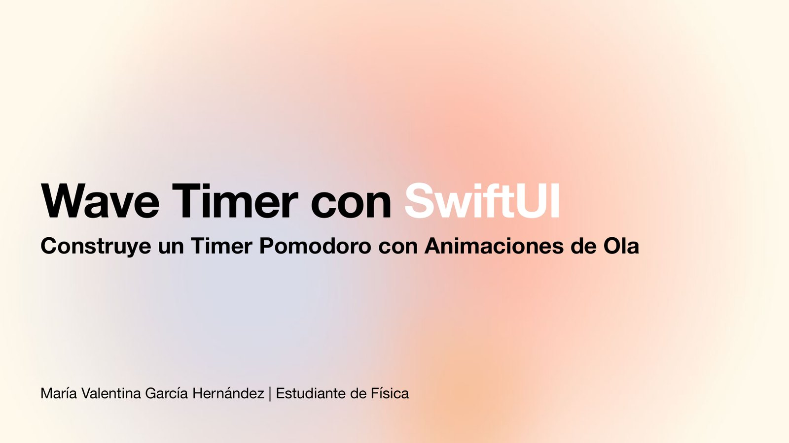
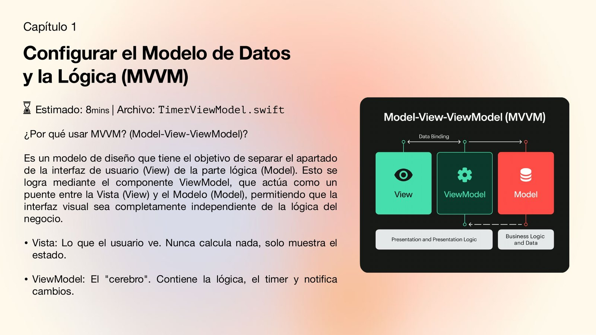
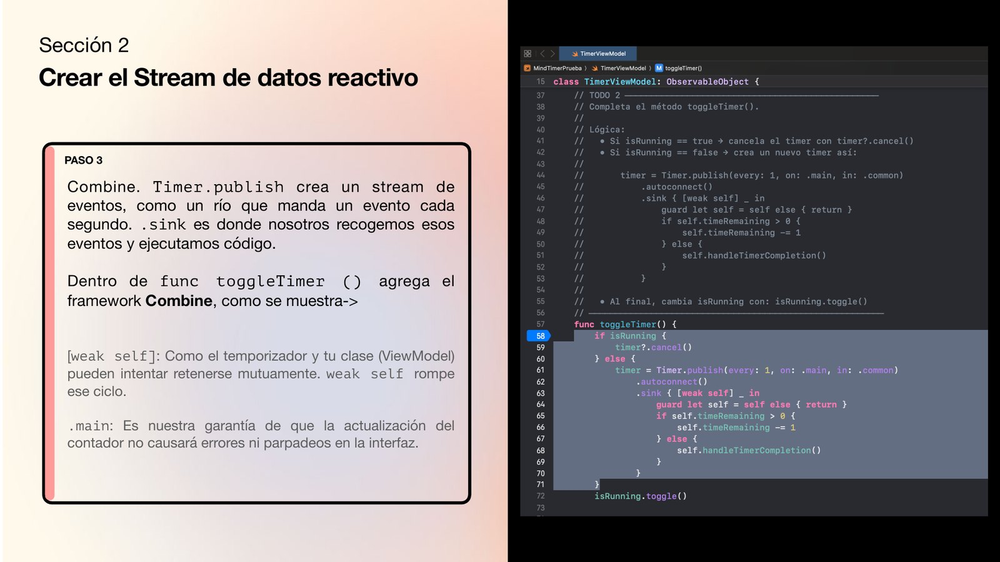
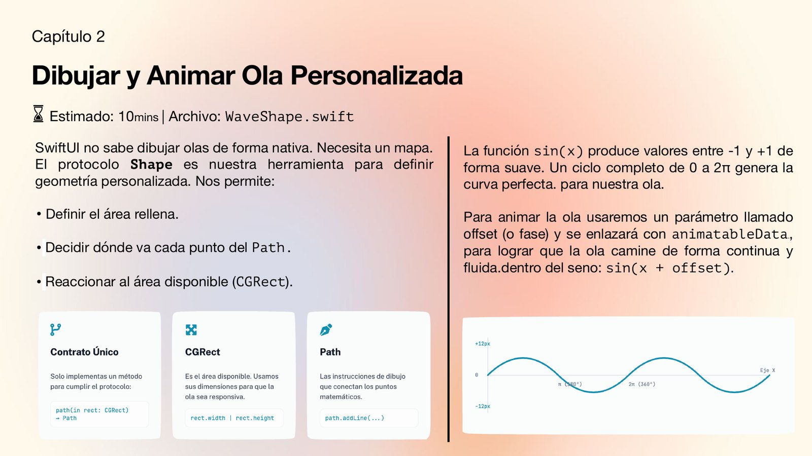
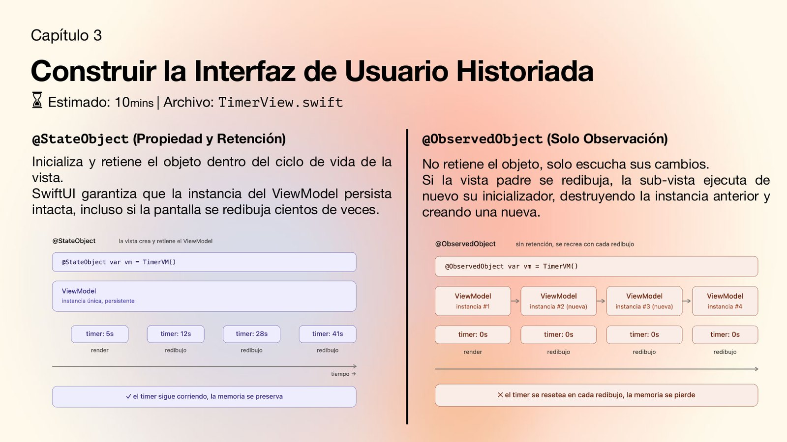
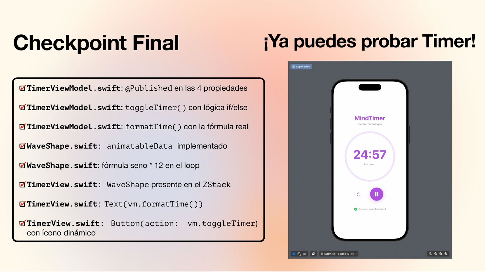

<div align="center">

**Español** | [English](README.en.md)

# Wave Timer con SwiftUI

**Taller práctico: construye un temporizador Pomodoro con animación de ola**


</div>

<p align="center">
  
</p>

## Descripción

Este repositorio contiene los materiales de un taller práctico de SwiftUI en el que los participantes construyen desde cero **MindTimer**, un temporizador Pomodoro para iOS con una animación de ola que sube conforme avanza el tiempo.

El taller se basa en la arquitectura de [MindTides](https://github.com/Valoo-1201/MindTides), una aplicación de productividad para estudiantes universitarios desarrollada para el Apple Swift Student Challenge. Durante la sesión se separa la lógica de la interfaz con el patrón MVVM, se implementa un flujo de tiempo reactivo con Combine y se diseña una forma animada personalizada con el protocolo `Shape`.

**Dirigido a:** estudiantes con conocimientos básicos de Swift que aún no han terminado una aplicación completa.

## Objetivos de aprendizaje

Al finalizar el taller, cada participante habrá:

- Construido una aplicación funcional de temporizador Pomodoro.
- Comprendido el patrón de arquitectura MVVM y su propósito.
- Implementado una forma personalizada y animada con el protocolo `Shape`.
- Conectado un `ViewModel` a una vista mediante `@StateObject` y `@Published`.
- Utilizado un temporizador reactivo de Combine con `Timer.publish`.

| Concepto | Herramienta |
|---|---|
| Separar la lógica de la interfaz | MVVM y `ObservableObject` |
| Notificar cambios a la vista | `@Published` |
| Dibujar formas personalizadas | Protocolo `Shape` y `Path` |
| Animar formas personalizadas | `animatableData` |
| Administrar el estado de la vista | `@StateObject` y `@ObservedObject` |
| Temporizador reactivo | `Timer.publish` y Combine |

## Contenido del repositorio

```
.
├── starter/
│   └── MindTimer.swiftpm           Proyecto inicial con 8 ejercicios (TODO) por completar
├── completed/
│   └── MindTimerCompleto.swiftpm   Solución completa del taller
├── materiales/
│   ├── Presentacion.pdf            Diapositivas del taller
│   ├── GuionTaller.md              Guion para el presentador: tiempos, explicaciones y preguntas
│   └── CheatSheet.md               Referencia rápida para los participantes
└── docs/images/                    Imágenes de este README
```

## Estructura del taller

| Sección | Tiempo | Archivo | Ejercicios |
|---|---|---|---|
| 1. Introducción y demostración | 5 min | — | — |
| 2. Arquitectura MVVM y el ViewModel | 8 min | `TimerViewModel.swift` | TODO 1 a 3 |
| 3. La forma de ola con `Shape` | 10 min | `WaveShape.swift` | TODO 4 y 5 |
| 4. La vista principal | 10 min | `TimerView.swift` | TODO 6 a 8 |
| 5. Demostración final y cierre | 5 min | — | — |

### Ejercicios

| TODO | Archivo | Tarea |
|---|---|---|
| 1 | `TimerViewModel.swift` | Agregar `@Published` a las cuatro propiedades de estado |
| 2 | `TimerViewModel.swift` | Implementar `toggleTimer()` con `Timer.publish` y `sink` |
| 3 | `TimerViewModel.swift` | Implementar `formatTime()` con el formato `MM:SS` |
| 4 | `WaveShape.swift` | Implementar `animatableData` |
| 5 | `WaveShape.swift` | Calcular la altura de la ola con la función seno |
| 6 | `TimerView.swift` | Agregar `WaveShape` al `ZStack` |
| 7 | `TimerView.swift` | Mostrar el tiempo con `vm.formatTime()` |
| 8 | `TimerView.swift` | Conectar el botón de reproducir y pausar con `vm.toggleTimer` |

## Vista previa de la presentación

<table>
  <tr>
    <td width="50%"><br /><sub>Capítulo 1: modelo de datos y lógica (MVVM)</sub></td>
    <td width="50%"><br /><sub>Paso guiado: flujo de datos reactivo con Combine</sub></td>
  </tr>
  <tr>
    <td width="50%"><br /><sub>Capítulo 2: dibujar y animar la ola</sub></td>
    <td width="50%"><br /><sub>Capítulo 3: <code>@StateObject</code> frente a <code>@ObservedObject</code></sub></td>
  </tr>
</table>

<p align="center">
  
</p>

## Requisitos

- iPad o Mac con Swift Playgrounds 4.4 o posterior, o Mac con Xcode 15 o posterior.
- iOS o iPadOS 16 o posterior para ejecutar la aplicación.

## Cómo usar este repositorio

### Participantes

1. Descargar el repositorio con **Code → Download ZIP** o clonarlo:
   ```bash
   git clone https://github.com/Valoo-1201/WaveTimer-SwiftUI-Workshop.git
   ```
2. Abrir `starter/MindTimer.swiftpm` en Swift Playgrounds o en Xcode.
3. Seguir la presentación y completar los ejercicios del TODO 1 al TODO 8, en orden.
4. Tener abierto `materiales/CheatSheet.md` como referencia durante el taller.
5. Si es necesario, comparar con la solución en `completed/MindTimerCompleto.swiftpm`.

### Presentadores

1. Revisar `materiales/GuionTaller.md`, que incluye tiempos, explicaciones, preguntas para el grupo y respuestas a dudas frecuentes.
2. Tener `completed/MindTimerCompleto.swiftpm` abierto y en ejecución para la demostración inicial.
3. Proyectar `materiales/Presentacion.pdf` durante la sesión.

## Resultado esperado

Al ejecutar la aplicación terminada:

- La ola se desplaza horizontalmente de forma continua.
- Al presionar reproducir, el contador disminuye y la ola sube.
- Al presionar pausa, el contador y el llenado se detienen.
- Al llegar a `00:00`, la aplicación cambia al modo de descanso (en color verde).
- El contador de sesiones completadas aumenta.

## Ejercicios adicionales

1. Agregar una segunda capa de ola con un desfase para dar profundidad.
2. Reproducir un sonido al terminar una sesión con `AVFoundation`.
3. Agregar retroalimentación háptica con `UIImpactFeedbackGenerator`.
4. Guardar las sesiones completadas con `@AppStorage`.
5. Permitir ajustar la duración del enfoque con un `Slider`.

## Recursos

- [Tutoriales de SwiftUI de Apple](https://developer.apple.com/tutorials/swiftui)
- [100 Days of SwiftUI, Hacking with Swift](https://www.hackingwithswift.com/100/swiftui)
- [Documentación de Combine](https://developer.apple.com/documentation/combine)

## Autora

María Valentina García Hernández ([Valoo-1201](https://github.com/Valoo-1201)), estudiante de Física.

Taller basado en [MindTides](https://github.com/Valoo-1201/MindTides).
